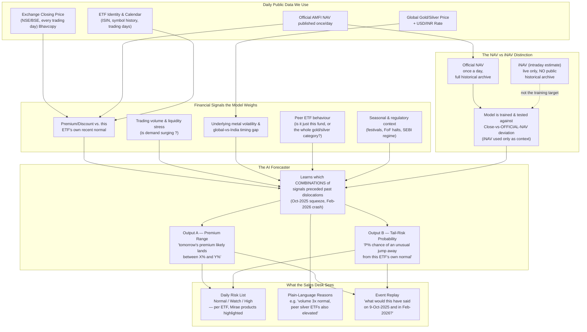
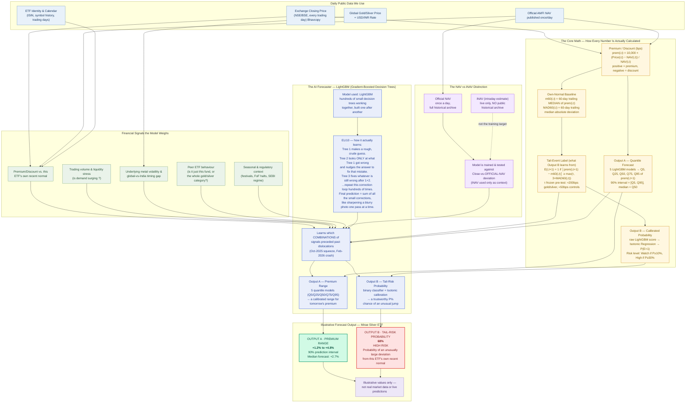
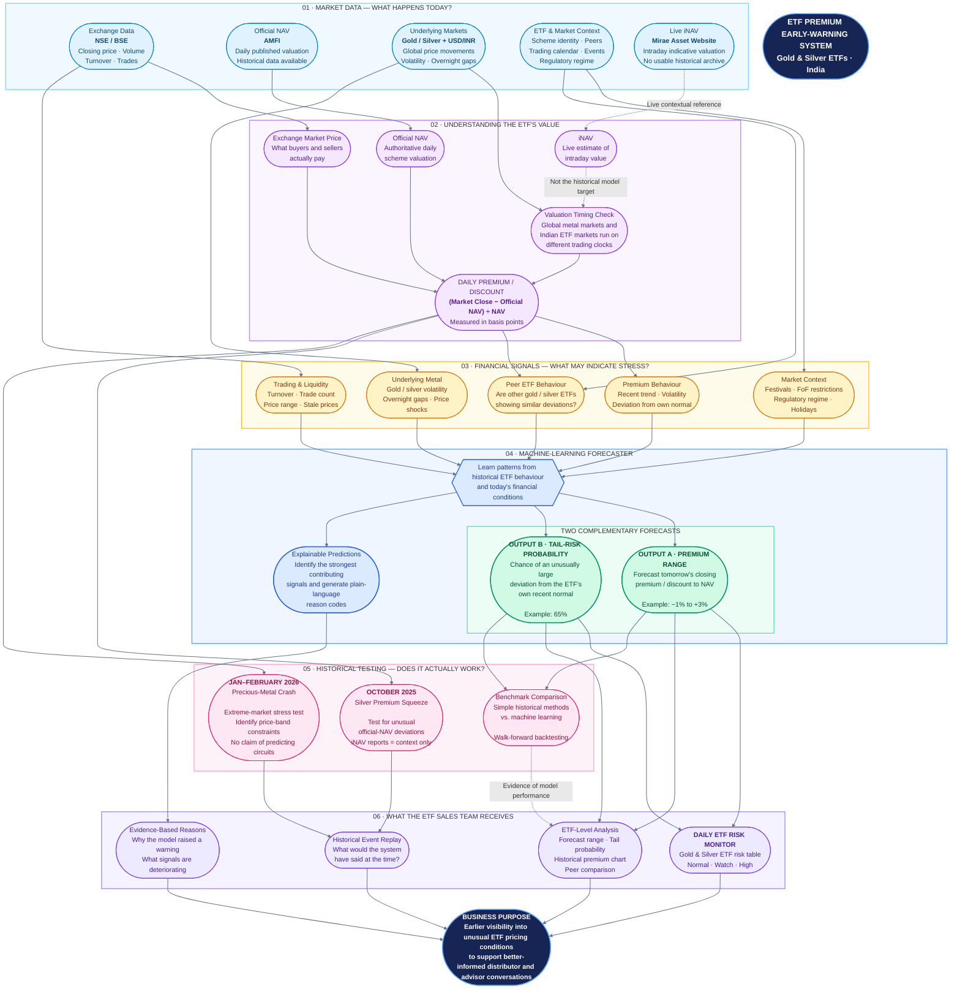

# ETF Premium Early-Warning — Architecture Flowcharts

Two diagrams, two audiences:

1. **Master Flowchart (Full Technical Detail)** — every component, every data check, every modelling and validation step. Use this as your own personal reference map of the entire system — if you ever forget how a piece fits, find it here.
2. **Simplified Pitch Flowchart (Financial-First)** — built for Umesh. Light on engineering jargon, explicit about the financial mechanics (NAV vs iNAV, the signals considered, the two prediction outputs). Meant to be understood at a glance.

Both diagrams use [Mermaid](https://mermaid.js.org/) syntax — they'll render automatically in GitHub, Claude, Obsidian, most modern Markdown viewers, or at [mermaid.live](https://mermaid.live) if you want to paste one in and inspect/export it as an image for a slide.

---

## 1. Master Flowchart — Full System Detail

*Every data source, every cleaning/validation step, every feature group, every model, every validation mechanism, every output. This is the "zoom all the way in" view.*

```mermaid
flowchart TD

%% ========== DATA SOURCES ==========
subgraph SRC["RAW DATA SOURCES (daily, free, public)"]
    NSE["NSE UDiFF CM Bhavcopy<br/>D1: OHLC, volume, turnover, trades<br/>2 schemas pre/post 8-Jul-2024"]
    BSE["BSE EOD Bhavcopy<br/>D1 fallback"]
    AMFI1["AMFI NAVAll.txt<br/>D2: latest NAV, all schemes"]
    AMFI2["AMFI NAV-History Download<br/>D2: max 90 days per request"]
    D4["Gold/Silver Global Benchmark Proxy<br/>D4: MCX / IBJA / LBMA-derived"]
    D5["USD/INR FX Reference<br/>D5: RBI/FBIL"]
    D7["Hand-built Scheme Master<br/>D7: ISIN, AMFI code, symbol history,<br/>issuer, metal, inception, creation unit"]
    D10["Trading Calendar<br/>D10: holidays + special sessions<br/>e.g. Sun 1-Feb-2026 Budget session"]
    EVT["Hand-made Events Table<br/>FoF halts/resumes, symbol changes,<br/>regime changes — 10-15 rows"]
end

%% ========== INGESTION ==========
subgraph ING["INGESTION LAYER"]
    DL["Download Scripts<br/>polite UA, delays, retry w/ backoff,<br/>prefer archive host over live site"]
    RAWSTORE[("Raw File Store<br/>immutable, checksummed, dated<br/>never edited in place")]
end

%% ========== CLEANING / VALIDATION ==========
subgraph CLN["CLEANING & VALIDATION"]
    SCHEMA["Schema Normalizer<br/>reconciles 2 bhavcopy layouts<br/>into one internal schema"]
    ISIN_KEY["Identity Resolution<br/>key on ISIN, NOT ticker<br/>e.g. SILVRETF -> SILVERAG (15-Sep-2025)"]
    CHK1["Price Sanity Checks<br/>high>=max(o,c,l), low<=min(...), vol>=0,<br/>1 row per ISIN/date"]
    CHK2["NAV Sanity Checks<br/>positive; day-over-day vs proxy return<br/>large gap -> flag NAV-timing issue"]
    CHK3["Cross-Source Check<br/>|close/NAV - 1| > 25% -> manual review"]
    CHK4["Mapping Check<br/>every universe ISIN has exactly<br/>1 AMFI code + >=1 exchange symbol"]
    CHK5["Coverage Report<br/>per-ETF first/last date, missing days"]
    SURV["Survivorship Handling<br/>include merged/renamed/delisted ETFs<br/>that existed during eval period"]
    CURATED[("Curated Parquet Tables<br/>queried via DuckDB")]
end

%% ========== DEFINITIONS LAYER ==========
subgraph DEF["CORE DEFINITIONS (computed per ETF-day)"]
    PREMDEF["prem(i,t) = 10000 x (Close - NAV) / NAV<br/>in basis points, vs OFFICIAL NAV<br/>(not iNAV — see Lesson flag)"]
    M60DEF["m60(i,t) = 60-day trailing median premium<br/>'this ETF's own normal'"]
    MADDEF["MAD60(i,t) = 60-day median absolute deviation"]
    REGIMEDEF["Regime Flag<br/>R0: until 30-Jan-2026<br/>R1: 1-Feb to 4-Sep-2026 (exchange-specific sub-history)<br/>R2: from 7-Sep-2026"]
    LOCKDEF["Circuit-Lock Flag<br/>uses ACTUAL historical applicable band<br/>(not a flat assumed +-20%) OR falls back to<br/>Confirmed / Potentially-Constrained / Unknown"]
end

%% ========== POINT-IN-TIME DISCIPLINE ==========
subgraph PIT["POINT-IN-TIME ENGINEERING (critical, cross-cutting)"]
    PITRULE["Rule: day-t feature row uses ONLY<br/>data dated <= t; NAV(t) usable for<br/>predicting t+1, not same-day t"]
    KNOWNAT["Event timestamps: effective_at vs known_at<br/>backtest features use known_at only<br/>(prevents notice-lag leakage)"]
    LEAKTEST["Automated Leak Test<br/>inject future value into one input,<br/>assert features don't change"]
    CANARY["Leaky-Canary Feature Test<br/>a feature literally equal to the future<br/>label must be auto-flagged by the harness"]
end

%% ========== FEATURE ENGINEERING ==========
subgraph FEAT["FEATURE BUILDER (~35-45 features/ETF/day)"]
    F1["F1 Premium Dynamics<br/>prem lags 0-5; rolling mean/median/std<br/>5/20/60d; MAD60; z-score; 5d slope;<br/>days since |prem|>tau"]
    F2["F2 Liquidity Proxies<br/>turnover/20d-avg ratio+zscore;<br/>trades-count z-score; (H-L)/C;<br/>zero/low-vol days; stale-price flag"]
    F3["F3 Underlying & Volatility<br/>proxy return 1/3/5d; realized vol 5/20d;<br/>largest overnight gap 5d; drawdown 10d high;<br/>NAV-vs-proxy residual (clock-mismatch signal)"]
    F4["F4 Peer Cross-Section<br/>peer-group median premium;<br/>own - peer median; peer dispersion;<br/>share of peers beyond tau"]
    F5["F5 Context<br/>metal; issuer; days since listing; regime flag;<br/>Dhanteras/Diwali/Akshaya Tritiya proximity;<br/>Union Budget window; active FoF-halt flag"]
    HANDLE["Robust scaling by group; winsorize;<br/>explicit missing-value flags (no silent imputation);<br/>first 60 days post-listing excluded from training<br/>(but still predicted, flagged low_history"]
end

%% ========== LABELS (ISOLATED MODULE) ==========
subgraph LAB["LABELS MODULE (import-isolated from features)"]
    TASKA_LBL["Task A Label<br/>prem(i,t+1) — the actual next-day premium"]
    TAUFREEZE["tau frozen pre-test<br/>per group: gold/silver ~200bps,<br/>controls ~50bps; train-period event rate 2-5%"]
    TASKB_LBL["Task B Label E(i,t+1) =<br/>1 if |prem(t+1) - m60(t)| >= max(tau, 3*MAD60(t))<br/>i.e. deviation from the ETF's OWN recent normal"]
    ABSWARN["Separate Absolute-Premium Warning<br/>(independent of tail-label) so a chronically<br/>expensive ETF can't 'normalize' into invisibility"]
end

%% ========== BASELINES ==========
subgraph BASE["BASELINES (must be beaten, out-of-sample)"]
    B0["B0 Persistence<br/>prem(t+1) = prem(t);<br/>interval from own recent forecast errors"]
    B1["B1 Rolling-Volatility Rule<br/>flag if |prem(t)-m60|>k*MAD60;<br/>PROBABILITY = historical conditional<br/>event frequency given current risk state"]
    B2["B2 Peer-Median Model<br/>peer-group rolling quantiles;<br/>PROBABILITY = peer-group historical<br/>tail-event frequency"]
end

%% ========== CORE MODELS ==========
subgraph MDL["CORE MODELS"]
    LGBMA["LightGBM Quantile Regression<br/>Task A: 5 models, one per quantile<br/>(5/25/50/75/95%), pooled across ETFs<br/>w/ metal+issuer+regime as features"]
    LGBMB["LightGBM Binary Classifier<br/>Task B: class-weighted,<br/>time-ordered validation split"]
    CQR["Conformalized Quantile Regression<br/>rolling time-ordered calibration window<br/>(>=250 ETF-days); widens/narrows intervals<br/>to hit target coverage; coverage checked<br/>SEPARATELY by period & ETF group<br/>(panel data isn't i.i.d.)"]
    ISO["Isotonic Regression<br/>calibrates Task B raw scores into<br/>trustworthy probabilities"]
    OPTUNA["Optuna Hyperparameter Search<br/>inside time-series CV, training data only"]
    SHAP["SHAP Value Attribution<br/>per-prediction feature contributions<br/>-> mapped to reason-code templates<br/>e.g. 'turnover 3.2x its 20-day average'"]
    ABLATE["Ablation Study<br/>drop F1-F5 each in turn,<br/>measure skill loss"]
end

%% ========== BACKTEST / VALIDATION ==========
subgraph BT["BACKTEST & VALIDATION"]
    WF["Walk-Forward, Expanding Window<br/>train through T, test next block,<br/>refit monthly, no shuffling"]
    PURGE["Purge / Embargo<br/>drop rows whose label window overlaps<br/>test block; 5-trading-day embargo"]
    SPLIT["Regime-Split Reporting<br/>R0 / R1 (exchange-specific) / R2<br/>reported separately; R2 flagged as short"]
    METRICS_A["Task A Metrics<br/>Pinball loss (+ % vs best baseline);<br/>90%/50% interval coverage; Kupiec test"]
    METRICS_B["Task B Metrics<br/>Brier skill score vs best PROBABILITY<br/>baseline; PR-AUC; reliability diagram;<br/>precision/recall at Watch/High;<br/>lead time; false alerts/ETF-month"]
    BOOT["Block Bootstrap<br/>~10-day blocks, resample by ETF+time,<br/>95% CIs; event count always printed alongside"]
    PREREG["Pre-Registration<br/>config/pre_registration.md — event defs,<br/>tau, thresholds, success criteria<br/>FROZEN before test runs"]
end

%% ========== EVENT STUDIES ==========
subgraph EVS["EVENT STUDIES (headline demonstration)"]
    E1["E1: Silver Premium Squeeze<br/>22-Sep to 24-Oct-2025<br/>Target: official-NAV deviation<br/>(iNAV reports kept as CONTEXT only,<br/>not the ground-truth label)"]
    E2["E2: Crash Stress Test<br/>26-Jan to 13-Feb-2026<br/>lock-days flagged, not silently excluded"]
    FWDLOG["Forward Test Log (optional stretch)<br/>forward_log.csv appended daily,<br/>git-committed for independent timestamp proof"]
end

%% ========== OUTPUTS ==========
subgraph OUT["OUTPUTS"]
    PREDCSV["predictions.csv<br/>isin, asof_date, target_date, regime,<br/>prem_now_bps, q05..q95, p_tail,<br/>risk_level, top_reasons, lock_flag,<br/>low_history_flag, model_id"]
    RISKMAP["Risk Level Mapping<br/>Normal / Watch (P>=10%) / High (P>=30%)<br/>— initial seed, FINAL thresholds tuned<br/>on train/val to an alert budget, then frozen"]
end

%% ========== DEMO / DASHBOARD ==========
subgraph DASH["STREAMLIT DEMO"]
    V1["View 1: Risk Table<br/>per-ETF premium, 5-95% interval,<br/>P(tail), risk level, sparkline, top reason"]
    V2["View 2: ETF Detail<br/>price-vs-NAV chart; forecast fan;<br/>probability gauge; reason-code panel;<br/>peer comparison; event markers"]
    V3["View 3: Event Replay<br/>date slider over E1/E2;<br/>'what the system would have said that day'"]
end

%% ========== TESTING ==========
subgraph TEST["TESTING HARNESS"]
    T1["Golden-file tests — both bhavcopy schemas,<br/>AMFI variants; idempotency"]
    T2["Universe tests — 1 ISIN:1 AMFI code;<br/>symbol-history lookups"]
    T3["Calendar tests — holiday/special-session logic"]
    T4["Feature unit tests + leak test + rebuild-equality"]
    T5["Label tests — synthetic-path; import-guard"]
    T6["Model tests — fixed-seed reproducibility;<br/>calibration check on frozen sample"]
    T7["Backtest tests — purge/embargo correctness;<br/>leaky-canary must be flagged"]
    T8["App smoke test — 3 views load from sample CSV"]
end

%% ===== FLOW CONNECTIONS =====
NSE --> DL
BSE --> DL
AMFI1 --> DL
AMFI2 --> DL
D4 --> DL
D5 --> DL
D7 --> DL
D10 --> DL
EVT --> DL
DL --> RAWSTORE
RAWSTORE --> SCHEMA
SCHEMA --> ISIN_KEY
ISIN_KEY --> CHK1 --> CHK2 --> CHK3 --> CHK4 --> CHK5
CHK5 --> SURV --> CURATED

CURATED --> PREMDEF --> M60DEF --> MADDEF
CURATED --> REGIMEDEF
CURATED --> LOCKDEF

PREMDEF --> PITRULE
EVT --> KNOWNAT --> PITRULE
PITRULE --> LEAKTEST
PITRULE --> CANARY

PITRULE --> F1
PITRULE --> F2
PITRULE --> F3
PITRULE --> F4
PITRULE --> F5
F1 --> HANDLE
F2 --> HANDLE
F3 --> HANDLE
F4 --> HANDLE
F5 --> HANDLE

M60DEF --> TASKA_LBL
MADDEF --> TASKB_LBL
TAUFREEZE --> TASKB_LBL
TASKA_LBL --> ABSWARN
TASKB_LBL --> ABSWARN

HANDLE --> B0
HANDLE --> B1
HANDLE --> B2
TASKA_LBL --> B0
TASKB_LBL --> B1
TASKB_LBL --> B2

HANDLE --> LGBMA
HANDLE --> LGBMB
TASKA_LBL --> LGBMA
TASKB_LBL --> LGBMB
OPTUNA --> LGBMA
OPTUNA --> LGBMB
LGBMA --> CQR
LGBMB --> ISO
LGBMA --> SHAP
LGBMB --> SHAP
HANDLE --> ABLATE

CQR --> WF
ISO --> WF
B0 --> WF
B1 --> WF
B2 --> WF
WF --> PURGE --> SPLIT
SPLIT --> METRICS_A
SPLIT --> METRICS_B
METRICS_A --> BOOT
METRICS_B --> BOOT
PREREG -.frozen before.-> E1
PREREG -.frozen before.-> E2
BOOT --> E1
BOOT --> E2
LOCKDEF --> E2
E1 --> FWDLOG
E2 --> FWDLOG

CQR --> PREDCSV
ISO --> PREDCSV
SHAP --> PREDCSV
LOCKDEF --> PREDCSV
RISKMAP --> PREDCSV

PREDCSV --> V1
PREDCSV --> V2
PREDCSV --> V3
E1 --> V3
E2 --> V3

T1 -.validates.-> ING
T2 -.validates.-> CLN
T3 -.validates.-> DEF
T4 -.validates.-> FEAT
T5 -.validates.-> LAB
T6 -.validates.-> MDL
T7 -.validates.-> BT
T8 -.validates.-> DASH
```

---

## 2. Financial flowchart

---

## More simpler

### another one

