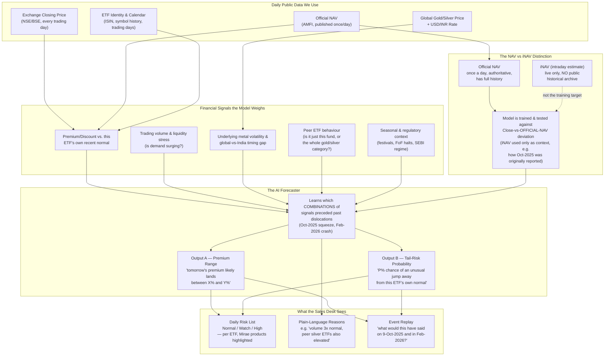

# ETF Premium Early-Warning — Architecture Flowcharts

Two diagrams, two audiences:

1. **Master Flowchart (Full Technical Detail)** — every component, every data check, every modelling and validation step. Use this as your own personal reference map of the entire system — if you ever forget how a piece fits, find it here.
2. **Simplified Pitch Flowchart (Financial-First)** — built for Umesh. Light on engineering jargon, explicit about the financial mechanics (NAV vs iNAV, the signals considered, the two prediction outputs). Meant to be understood at a glance.

Both diagrams use [Mermaid](https://mermaid.js.org/) syntax — they'll render automatically in GitHub, Claude, Obsidian, most modern Markdown viewers, or at [mermaid.live](https://mermaid.live) if you want to paste one in and inspect/export it as an image for a slide.

---

## 1. Master Flowchart — Full System Detail

*Every data source, every cleaning/validation step, every feature group, every model, every validation mechanism, every output. This is the "zoom all the way in" view.*

```mermaid
flowchart TD

%% ========== DATA SOURCES ==========
subgraph SRC["RAW DATA SOURCES (daily, free, public)"]
    NSE["NSE UDiFF CM Bhavcopy<br/>D1: OHLC, volume, turnover, trades<br/>2 schemas pre/post 8-Jul-2024"]
    BSE["BSE EOD Bhavcopy<br/>D1 fallback"]
    AMFI1["AMFI NAVAll.txt<br/>D2: latest NAV, all schemes"]
    AMFI2["AMFI NAV-History Download<br/>D2: max 90 days per request"]
    D4["Gold/Silver Global Benchmark Proxy<br/>D4: MCX / IBJA / LBMA-derived"]
    D5["USD/INR FX Reference<br/>D5: RBI/FBIL"]
    D7["Hand-built Scheme Master<br/>D7: ISIN, AMFI code, symbol history,<br/>issuer, metal, inception, creation unit"]
    D10["Trading Calendar<br/>D10: holidays + special sessions<br/>e.g. Sun 1-Feb-2026 Budget session"]
    EVT["Hand-made Events Table<br/>FoF halts/resumes, symbol changes,<br/>regime changes — 10-15 rows"]
end

%% ========== INGESTION ==========
subgraph ING["INGESTION LAYER"]
    DL["Download Scripts<br/>polite UA, delays, retry w/ backoff,<br/>prefer archive host over live site"]
    RAWSTORE[("Raw File Store<br/>immutable, checksummed, dated<br/>never edited in place")]
end

%% ========== CLEANING / VALIDATION ==========
subgraph CLN["CLEANING & VALIDATION"]
    SCHEMA["Schema Normalizer<br/>reconciles 2 bhavcopy layouts<br/>into one internal schema"]
    ISIN_KEY["Identity Resolution<br/>key on ISIN, NOT ticker<br/>e.g. SILVRETF -> SILVERAG (15-Sep-2025)"]
    CHK1["Price Sanity Checks<br/>high>=max(o,c,l), low<=min(...), vol>=0,<br/>1 row per ISIN/date"]
    CHK2["NAV Sanity Checks<br/>positive; day-over-day vs proxy return<br/>large gap -> flag NAV-timing issue"]
    CHK3["Cross-Source Check<br/>|close/NAV - 1| > 25% -> manual review"]
    CHK4["Mapping Check<br/>every universe ISIN has exactly<br/>1 AMFI code + >=1 exchange symbol"]
    CHK5["Coverage Report<br/>per-ETF first/last date, missing days"]
    SURV["Survivorship Handling<br/>include merged/renamed/delisted ETFs<br/>that existed during eval period"]
    CURATED[("Curated Parquet Tables<br/>queried via DuckDB")]
end

%% ========== DEFINITIONS LAYER ==========
subgraph DEF["CORE DEFINITIONS (computed per ETF-day)"]
    PREMDEF["prem(i,t) = 10000 x (Close - NAV) / NAV<br/>in basis points, vs OFFICIAL NAV<br/>(not iNAV — see Lesson flag)"]
    M60DEF["m60(i,t) = 60-day trailing median premium<br/>'this ETF's own normal'"]
    MADDEF["MAD60(i,t) = 60-day median absolute deviation"]
    REGIMEDEF["Regime Flag<br/>R0: until 30-Jan-2026<br/>R1: 1-Feb to 4-Sep-2026 (exchange-specific sub-history)<br/>R2: from 7-Sep-2026"]
    LOCKDEF["Circuit-Lock Flag<br/>uses ACTUAL historical applicable band<br/>(not a flat assumed +-20%) OR falls back to<br/>Confirmed / Potentially-Constrained / Unknown"]
end

%% ========== POINT-IN-TIME DISCIPLINE ==========
subgraph PIT["POINT-IN-TIME ENGINEERING (critical, cross-cutting)"]
    PITRULE["Rule: day-t feature row uses ONLY<br/>data dated <= t; NAV(t) usable for<br/>predicting t+1, not same-day t"]
    KNOWNAT["Event timestamps: effective_at vs known_at<br/>backtest features use known_at only<br/>(prevents notice-lag leakage)"]
    LEAKTEST["Automated Leak Test<br/>inject future value into one input,<br/>assert features don't change"]
    CANARY["Leaky-Canary Feature Test<br/>a feature literally equal to the future<br/>label must be auto-flagged by the harness"]
end

%% ========== FEATURE ENGINEERING ==========
subgraph FEAT["FEATURE BUILDER (~35-45 features/ETF/day)"]
    F1["F1 Premium Dynamics<br/>prem lags 0-5; rolling mean/median/std<br/>5/20/60d; MAD60; z-score; 5d slope;<br/>days since |prem|>tau"]
    F2["F2 Liquidity Proxies<br/>turnover/20d-avg ratio+zscore;<br/>trades-count z-score; (H-L)/C;<br/>zero/low-vol days; stale-price flag"]
    F3["F3 Underlying & Volatility<br/>proxy return 1/3/5d; realized vol 5/20d;<br/>largest overnight gap 5d; drawdown 10d high;<br/>NAV-vs-proxy residual (clock-mismatch signal)"]
    F4["F4 Peer Cross-Section<br/>peer-group median premium;<br/>own - peer median; peer dispersion;<br/>share of peers beyond tau"]
    F5["F5 Context<br/>metal; issuer; days since listing; regime flag;<br/>Dhanteras/Diwali/Akshaya Tritiya proximity;<br/>Union Budget window; active FoF-halt flag"]
    HANDLE["Robust scaling by group; winsorize;<br/>explicit missing-value flags (no silent imputation);<br/>first 60 days post-listing excluded from training<br/>(but still predicted, flagged low_history"]
end

%% ========== LABELS (ISOLATED MODULE) ==========
subgraph LAB["LABELS MODULE (import-isolated from features)"]
    TASKA_LBL["Task A Label<br/>prem(i,t+1) — the actual next-day premium"]
    TAUFREEZE["tau frozen pre-test<br/>per group: gold/silver ~200bps,<br/>controls ~50bps; train-period event rate 2-5%"]
    TASKB_LBL["Task B Label E(i,t+1) =<br/>1 if |prem(t+1) - m60(t)| >= max(tau, 3*MAD60(t))<br/>i.e. deviation from the ETF's OWN recent normal"]
    ABSWARN["Separate Absolute-Premium Warning<br/>(independent of tail-label) so a chronically<br/>expensive ETF can't 'normalize' into invisibility"]
end

%% ========== BASELINES ==========
subgraph BASE["BASELINES (must be beaten, out-of-sample)"]
    B0["B0 Persistence<br/>prem(t+1) = prem(t);<br/>interval from own recent forecast errors"]
    B1["B1 Rolling-Volatility Rule<br/>flag if |prem(t)-m60|>k*MAD60;<br/>PROBABILITY = historical conditional<br/>event frequency given current risk state"]
    B2["B2 Peer-Median Model<br/>peer-group rolling quantiles;<br/>PROBABILITY = peer-group historical<br/>tail-event frequency"]
end

%% ========== CORE MODELS ==========
subgraph MDL["CORE MODELS"]
    LGBMA["LightGBM Quantile Regression<br/>Task A: 5 models, one per quantile<br/>(5/25/50/75/95%), pooled across ETFs<br/>w/ metal+issuer+regime as features"]
    LGBMB["LightGBM Binary Classifier<br/>Task B: class-weighted,<br/>time-ordered validation split"]
    CQR["Conformalized Quantile Regression<br/>rolling time-ordered calibration window<br/>(>=250 ETF-days); widens/narrows intervals<br/>to hit target coverage; coverage checked<br/>SEPARATELY by period & ETF group<br/>(panel data isn't i.i.d.)"]
    ISO["Isotonic Regression<br/>calibrates Task B raw scores into<br/>trustworthy probabilities"]
    OPTUNA["Optuna Hyperparameter Search<br/>inside time-series CV, training data only"]
    SHAP["SHAP Value Attribution<br/>per-prediction feature contributions<br/>-> mapped to reason-code templates<br/>e.g. 'turnover 3.2x its 20-day average'"]
    ABLATE["Ablation Study<br/>drop F1-F5 each in turn,<br/>measure skill loss"]
end

%% ========== BACKTEST / VALIDATION ==========
subgraph BT["BACKTEST & VALIDATION"]
    WF["Walk-Forward, Expanding Window<br/>train through T, test next block,<br/>refit monthly, no shuffling"]
    PURGE["Purge / Embargo<br/>drop rows whose label window overlaps<br/>test block; 5-trading-day embargo"]
    SPLIT["Regime-Split Reporting<br/>R0 / R1 (exchange-specific) / R2<br/>reported separately; R2 flagged as short"]
    METRICS_A["Task A Metrics<br/>Pinball loss (+ % vs best baseline);<br/>90%/50% interval coverage; Kupiec test"]
    METRICS_B["Task B Metrics<br/>Brier skill score vs best PROBABILITY<br/>baseline; PR-AUC; reliability diagram;<br/>precision/recall at Watch/High;<br/>lead time; false alerts/ETF-month"]
    BOOT["Block Bootstrap<br/>~10-day blocks, resample by ETF+time,<br/>95% CIs; event count always printed alongside"]
    PREREG["Pre-Registration<br/>config/pre_registration.md — event defs,<br/>tau, thresholds, success criteria<br/>FROZEN before test runs"]
end

%% ========== EVENT STUDIES ==========
subgraph EVS["EVENT STUDIES (headline demonstration)"]
    E1["E1: Silver Premium Squeeze<br/>22-Sep to 24-Oct-2025<br/>Target: official-NAV deviation<br/>(iNAV reports kept as CONTEXT only,<br/>not the ground-truth label)"]
    E2["E2: Crash Stress Test<br/>26-Jan to 13-Feb-2026<br/>lock-days flagged, not silently excluded"]
    FWDLOG["Forward Test Log (optional stretch)<br/>forward_log.csv appended daily,<br/>git-committed for independent timestamp proof"]
end

%% ========== OUTPUTS ==========
subgraph OUT["OUTPUTS"]
    PREDCSV["predictions.csv<br/>isin, asof_date, target_date, regime,<br/>prem_now_bps, q05..q95, p_tail,<br/>risk_level, top_reasons, lock_flag,<br/>low_history_flag, model_id"]
    RISKMAP["Risk Level Mapping<br/>Normal / Watch (P>=10%) / High (P>=30%)<br/>— initial seed, FINAL thresholds tuned<br/>on train/val to an alert budget, then frozen"]
end

%% ========== DEMO / DASHBOARD ==========
subgraph DASH["STREAMLIT DEMO"]
    V1["View 1: Risk Table<br/>per-ETF premium, 5-95% interval,<br/>P(tail), risk level, sparkline, top reason"]
    V2["View 2: ETF Detail<br/>price-vs-NAV chart; forecast fan;<br/>probability gauge; reason-code panel;<br/>peer comparison; event markers"]
    V3["View 3: Event Replay<br/>date slider over E1/E2;<br/>'what the system would have said that day'"]
end

%% ========== TESTING ==========
subgraph TEST["TESTING HARNESS"]
    T1["Golden-file tests — both bhavcopy schemas,<br/>AMFI variants; idempotency"]
    T2["Universe tests — 1 ISIN:1 AMFI code;<br/>symbol-history lookups"]
    T3["Calendar tests — holiday/special-session logic"]
    T4["Feature unit tests + leak test + rebuild-equality"]
    T5["Label tests — synthetic-path; import-guard"]
    T6["Model tests — fixed-seed reproducibility;<br/>calibration check on frozen sample"]
    T7["Backtest tests — purge/embargo correctness;<br/>leaky-canary must be flagged"]
    T8["App smoke test — 3 views load from sample CSV"]
end

%% ===== FLOW CONNECTIONS =====
NSE --> DL
BSE --> DL
AMFI1 --> DL
AMFI2 --> DL
D4 --> DL
D5 --> DL
D7 --> DL
D10 --> DL
EVT --> DL
DL --> RAWSTORE
RAWSTORE --> SCHEMA
SCHEMA --> ISIN_KEY
ISIN_KEY --> CHK1 --> CHK2 --> CHK3 --> CHK4 --> CHK5
CHK5 --> SURV --> CURATED

CURATED --> PREMDEF --> M60DEF --> MADDEF
CURATED --> REGIMEDEF
CURATED --> LOCKDEF

PREMDEF --> PITRULE
EVT --> KNOWNAT --> PITRULE
PITRULE --> LEAKTEST
PITRULE --> CANARY

PITRULE --> F1
PITRULE --> F2
PITRULE --> F3
PITRULE --> F4
PITRULE --> F5
F1 --> HANDLE
F2 --> HANDLE
F3 --> HANDLE
F4 --> HANDLE
F5 --> HANDLE

M60DEF --> TASKA_LBL
MADDEF --> TASKB_LBL
TAUFREEZE --> TASKB_LBL
TASKA_LBL --> ABSWARN
TASKB_LBL --> ABSWARN

HANDLE --> B0
HANDLE --> B1
HANDLE --> B2
TASKA_LBL --> B0
TASKB_LBL --> B1
TASKB_LBL --> B2

HANDLE --> LGBMA
HANDLE --> LGBMB
TASKA_LBL --> LGBMA
TASKB_LBL --> LGBMB
OPTUNA --> LGBMA
OPTUNA --> LGBMB
LGBMA --> CQR
LGBMB --> ISO
LGBMA --> SHAP
LGBMB --> SHAP
HANDLE --> ABLATE

CQR --> WF
ISO --> WF
B0 --> WF
B1 --> WF
B2 --> WF
WF --> PURGE --> SPLIT
SPLIT --> METRICS_A
SPLIT --> METRICS_B
METRICS_A --> BOOT
METRICS_B --> BOOT
PREREG -.frozen before.-> E1
PREREG -.frozen before.-> E2
BOOT --> E1
BOOT --> E2
LOCKDEF --> E2
E1 --> FWDLOG
E2 --> FWDLOG

CQR --> PREDCSV
ISO --> PREDCSV
SHAP --> PREDCSV
LOCKDEF --> PREDCSV
RISKMAP --> PREDCSV

PREDCSV --> V1
PREDCSV --> V2
PREDCSV --> V3
E1 --> V3
E2 --> V3

T1 -.validates.-> ING
T2 -.validates.-> CLN
T3 -.validates.-> DEF
T4 -.validates.-> FEAT
T5 -.validates.-> LAB
T6 -.validates.-> MDL
T7 -.validates.-> BT
T8 -.validates.-> DASH
```

---

## 2. Simplified Pitch Flowchart — For Umesh

*Financial mechanics first, engineering kept to the minimum needed to show the pipeline is real. Designed to be read top-to-bottom in under a minute.*

---

### Notes for using these

- **Mermaid rendering tip:** if you want a clean PNG/SVG for a slide, paste either block into [mermaid.live](https://mermaid.live) and export. GitHub and Claude's own chat/artifact view also render these natively.
- **The two flowcharts deliberately disagree on vocabulary** — the master one uses engineering terms (pandera, DuckDB, CQR, isotonic regression) on purpose, since it's your own reference. The Umesh-facing one avoids all of that; everything in it is a financial or data-availability concept he already understands, framed around the project.
- **The NAV-vs-iNAV box in the second diagram is there deliberately** — it's the one subtle point worth being precise about even in a simplified pitch, per the open correction flagged earlier: the project's evidence (Oct 2025) was originally reported against iNAV, but the model itself is built and tested against the official NAV. Keeping this box small but present means you won't accidentally misstate it live.
