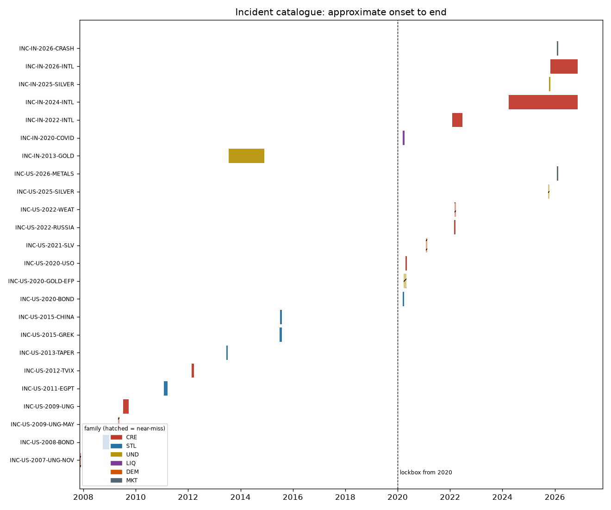

# Incident and operational-event catalogue (P03)

Model estimate context only; not investment advice. Mechanism labels are agent-assigned (pass 1 and pass 2) pending the user's review (MI-08).

## Counts

- Incidents: **24** (17 US, 7 India); near-misses: 6; usable for validation: 19
- Operational events: **48**; month-precision rows: 2
- Capacity rows: **596** for 9 instruments

### By period and family

| row_0      |   CRE |   DEM |   LIQ |   MKT |   STL |   UND |
|:-----------|------:|------:|------:|------:|------:|------:|
| India      |     3 |     0 |     1 |     1 |     0 |     2 |
| US dev     |     4 |     0 |     0 |     0 |     5 |     0 |
| US lockbox |     3 |     1 |     0 |     1 |     1 |     2 |

### Operational events by type

| type                       |   events |
|:---------------------------|---------:|
| creation_suspended         |        7 |
| subscription_halt_fof      |        7 |
| prospectus_risk_warning    |        6 |
| subscription_resume_fof    |        6 |
| registration_effective     |        4 |
| creation_resumed           |        4 |
| market_closure_unscheduled |        3 |
| market_reopen              |        3 |
| trading_halt               |        3 |
| fund_liquidation_announced |        2 |
| industry_cap_stop          |        2 |
| creation_limited           |        1 |

## Incidents

| incident_id          | primary_family   | mechanisms   | direction   | approx_onset   | approx_end   | near_miss   | include_in_validation   | grade   |
|:---------------------|:-----------------|:-------------|:------------|:---------------|:-------------|:------------|:------------------------|:--------|
| INC-US-2008-BOND     | STL              | M3;M5;M8     | DISCOUNT    | 2008-10-01     | 2008-12-31   | n           | y                       | R       |
| INC-US-2009-UNG      | CRE              | M1;M6        | PREMIUM     | 2009-07-07     | 2009-09-28   | n           | y                       | V       |
| INC-US-2011-EGPT     | STL              | M3;M1        | PREMIUM     | 2011-01-31     | 2011-03-23   | n           | n                       | R       |
| INC-US-2012-TVIX     | CRE              | M1;M6        | PREMIUM     | 2012-02-22     | 2012-03-23   | n           | n                       | R       |
| INC-US-2013-TAPER    | STL              | M3;M8;M5     | DISCOUNT    | 2013-06-19     | 2013-06-28   | n           | y                       | R       |
| INC-US-2015-GREK     | STL              | M3           | PREMIUM     | 2015-06-29     | 2015-08-03   | n           | y                       | V       |
| INC-US-2015-CHINA    | STL              | M3;M8        | DISCOUNT    | 2015-07-06     | 2015-07-31   | n           | y                       | R       |
| INC-US-2020-BOND     | STL              | M3;M5;M8     | DISCOUNT    | 2020-03-09     | 2020-03-24   | n           | y                       | V       |
| INC-US-2020-GOLD-EFP | UND              | M2;M8        | BOTH        | 2020-03-23     | 2020-04-30   | y           | y                       | R       |
| INC-US-2020-USO      | CRE              | M1;M6        | PREMIUM     | 2020-04-21     | 2020-05-01   | n           | y                       | V       |
| INC-US-2021-SLV      | DEM              | M6;M2        | PREMIUM     | 2021-01-29     | 2021-02-05   | y           | y                       | V       |
| INC-US-2022-RUSSIA   | CRE              | M1;M3;M8     | PREMIUM     | 2022-02-24     | 2022-03-04   | n           | n                       | R       |
| INC-US-2022-WEAT     | CRE              | M1;M6        | PREMIUM     | 2022-03-07     | 2022-03-09   | y           | n                       | V       |
| INC-US-2009-UNG-MAY  | CRE              | M1           | PREMIUM     | 2009-05-01     | 2009-05-06   | y           | y                       | V       |
| INC-US-2007-UNG-NOV  | CRE              | M1           | PREMIUM     | 2007-11-09     | 2007-11-21   | y           | n                       | V       |
| INC-US-2025-SILVER   | UND              | M2;M6        | PREMIUM     | 2025-10-01     | 2025-10-21   | y           | y                       | R       |
| INC-US-2026-METALS   | MKT              | M8;M6;M5     | BOTH        | 2026-01-29     | 2026-02-06   | n           | y                       | V       |
| INC-IN-2013-GOLD     | UND              | M4;M2        | PREMIUM     | 2013-07-22     | 2014-11-28   | n           | y                       | R       |
| INC-IN-2020-COVID    | LIQ              | M5;M8        | BOTH        | 2020-03-09     | 2020-04-09   | n           | y                       | R       |
| INC-IN-2022-INTL     | CRE              | M1           | PREMIUM     | 2022-02-02     | 2022-06-21   | n           | y                       | R       |
| INC-IN-2024-INTL     | CRE              | M1           | PREMIUM     | 2024-04-01     |              | n           | y                       | R       |
| INC-IN-2025-SILVER   | UND              | M2;M4;M6     | PREMIUM     | 2025-10-09     | 2025-10-17   | n           | y                       | R       |
| INC-IN-2026-CRASH    | MKT              | M8;M7        | DISCOUNT    | 2026-02-01     | 2026-02-06   | n           | y                       | R       |
| INC-IN-2026-INTL     | CRE              | M1;M6        | PREMIUM     | 2025-11-01     |              | n           | y                       | R       |

## Rows with month precision (excluded from features)

| event_id            | type                    | effective_at   | notes                                                                                         |
|:--------------------|:------------------------|:---------------|:----------------------------------------------------------------------------------------------|
| OE-US-2011-EGPT-02  | creation_resumed        | 2011-03-01     | Creations resumed in late March 2011 (exact day not found): month precision                   |
| OE-IN-2022-MIRAE-02 | subscription_resume_fof | 2022-06-01     | Mirae resumed overseas FoF lumpsum with a Rs 2 lakh/day cap (late June 2022): month precision |

## Double review

- pass 1 vs pass 2, primary family: 22 of 24 (91.7%)
- pass 1 vs pass 2, primary mechanism code: 22 of 24 (91.7%)
- disagreements: INC-US-2022-RUSSIA (pass 1 CRE, pass 2 STL); INC-IN-2020-COVID (pass 1 LIQ, pass 2 MKT); both flagged for the user (MI-08)
- caveat: same agent; pass 2 was a later re-read, not blind to pass 1, so agreement overstates independence (AS-06 evidence is weak until MI-08)
- agent vs user: pending MI-08

## Source capture

- 91 source pages saved under `data/raw/catalogue_sources/`; failures (paywalls, 403) are listed in `source_capture.csv` — the URL and grade stay in the tables.
