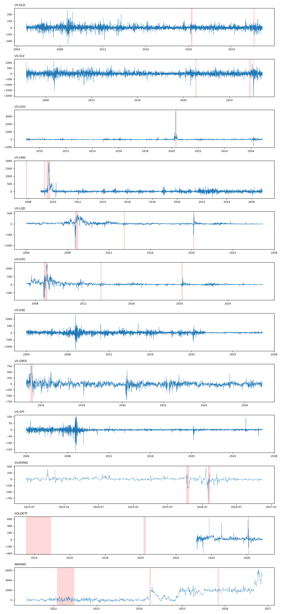

# Premium EDA (P08)

Premium = 10,000 × (close / NAV − 1), valid rows only (Spec §4.3). Model estimate context only; not investment advice.

## Premium quantiles by group (bps)

| group        |     p1 |     p5 |   p50 |    p95 |    p99 |
|:-------------|-------:|-------:|------:|-------:|-------:|
| IN_CTRL      |  -66.5 |  -27.5 |   7.6 |   41.7 |  127.9 |
| IN_DEBT      | -397.8 |  -74.9 |   5.5 |  102.8 |  418.1 |
| IN_GOLD      | -539.8 | -293.1 | -10.8 |  141.8 |  619.4 |
| IN_INTL      | -560.1 | -294.3 | 187.9 | 2098.1 | 4151.6 |
| IN_SILVER    | -374.2 | -179.5 |  -1   |  113.6 |  276.5 |
| US_BOND      |  -85   |  -26.1 |  12.2 |  103   |  261.7 |
| US_COMM_FUT  | -116.9 |  -61   |   0   |   66.1 |  166.6 |
| US_COMM_PHYS | -293   | -135.5 |   6.4 |  158   |  325.6 |
| US_CTRL      |  -30.5 |  -12.3 |   0.3 |   11   |   25.4 |
| US_INTL      | -265.3 | -122.8 |   1.7 |  123   |  242.7 |

## Robust scale s (median over time, bps) per instrument

| instrument_id   |   s_bps |
|:----------------|--------:|
| US:SPY          |     5   |
| US:IVV          |     5   |
| US:QQQ          |     5   |
| US:DIA          |     5   |
| US:IWM          |     6.1 |
| US:AGG          |     7.2 |
| IN:INF247L01AK4 |    11.1 |
| IN:INF769K01EG9 |    11.3 |
| US:TLT          |    11.5 |
| IN:INF204KC1030 |    12.8 |
| US:DBA          |    13.1 |
| IN:INF732E01045 |    14.6 |
| US:MUB          |    15.1 |
| US:USCI         |    15.2 |
| IN:INF0R8F01133 |    15.3 |
| US:DBC          |    15.5 |
| US:BKLN         |    15.8 |
| IN:INF204KB14I2 |    16.2 |
| US:LQD          |    16.5 |
| IN:INF204KB15I9 |    17.5 |
| IN:INF200KA1FS1 |    18.5 |
| IN:INF754K01LE1 |    19.6 |
| IN:INF754K01QX0 |    19.7 |
| IN:INF754K01OB1 |    20.6 |
| US:JNK          |    21   |
| IN:INF754K01KO2 |    21.3 |
| IN:INF204KB1882 |    21.4 |
| US:EMB          |    21.9 |
| US:GSG          |    23   |
| IN:INF0R8F01042 |    25.4 |
| IN:INF200KA1JT1 |    25.5 |
| US:BNO          |    25.8 |
| US:UGA          |    26   |
| IN:INF740KA1ZP2 |    26   |
| IN:INF109KC18O0 |    27   |
| US:HYG          |    27   |
| US:USL          |    27.2 |
| IN:INF346A01034 |    27.5 |
| IN:INF204KC1402 |    27.9 |
| US:USO          |    27.9 |
| US:DBO          |    28.1 |
| IN:INF754K01SE6 |    28.4 |
| IN:INF204KB17I5 |    28.9 |
| IN:INF769K01JP9 |    29   |
| IN:INF666M01OE7 |    29.3 |
| IN:INF2KCX01012 |    30.4 |
| IN:INF209KC1134 |    31.2 |
| IN:INF251K01SU9 |    31.4 |
| IN:INF209KC1142 |    31.6 |
| IN:INF174KA1ZD3 |    32.1 |
| IN:INF754K01SF3 |    32.7 |
| IN:INF109KC1Y56 |    33.1 |
| US:UNL          |    33.6 |
| US:CPER         |    34.9 |
| IN:INF582M01KS4 |    35.9 |
| IN:INF769K01KF8 |    36   |
| IN:INF0R8F01091 |    36.1 |
| IN:INF740KA1ZQ0 |    36.2 |
| IN:INF1J2R01114 |    36.9 |
| IN:INF579M01BB5 |    37.2 |
| IN:INF769K01KG6 |    37.3 |
| US:IAU          |    37.4 |
| US:EWW          |    38.2 |
| US:UNG          |    39.6 |
| IN:INF247L01FY4 |    42.2 |
| US:GLDM         |    42.4 |
| US:GLD          |    42.7 |
| IN:INF209KB19F6 |    43.4 |
| IN:INF200KB1217 |    43.7 |
| US:EWZ          |    43.7 |
| IN:INF082J01408 |    46.1 |
| IN:INF277KA1976 |    46.5 |
| IN:INF789F1AZE6 |    48.1 |
| IN:INF109KC14A8 |    48.9 |
| IN:INF200KA16D8 |    50   |
| IN:INF767K01SM1 |    50.9 |
| IN:INF789F1AZF3 |    51.4 |
| IN:INF666M01OF4 |    52.4 |
| IN:INF179KC1981 |    52.7 |
| IN:INF846K011K1 |    54.1 |
| IN:INF579M01BC3 |    54.5 |
| US:EWH          |    56.3 |
| US:INDA         |    57.5 |
| US:EEM          |    57.7 |
| IN:INF277KA1984 |    59.6 |
| IN:INF109KC1NT3 |    59.7 |
| IN:INF767K01MV5 |    60.8 |
| IN:INF247L01FZ1 |    61.7 |
| US:TUR          |    62.2 |
| IN:INF174KA1HJ8 |    62.8 |
| IN:INF846K01W80 |    63   |
| IN:INF205KA1BP1 |    63.7 |
| US:EWJ          |    68.6 |
| US:GREK         |    69.6 |
| IN:INF789F1AYK6 |    70.2 |
| US:FXI          |    73.4 |
| IN:INF789F1AUX7 |    80.4 |
| IN:INF209KB18D3 |    81.9 |
| IN:INF179KC1DI2 |    87.6 |
| US:SLV          |   118   |
| IN:INF247L01AP3 |   166.6 |
| IN:INF769K01HP3 |   171.1 |
| IN:INF769K01HF4 |   248.1 |
| IN:INF769K01HS7 |   271.4 |
| IN:INF247L01AU3 |   371.5 |
| IN:INF204KB19I1 |   475.9 |

## Share of days with |z| > 3 by year

|   year |   IN_CTRL |   IN_DEBT |   IN_GOLD |   IN_INTL |   IN_SILVER |   US_BOND |   US_COMM_FUT |   US_COMM_PHYS |   US_CTRL |   US_INTL |
|-------:|----------:|----------:|----------:|----------:|------------:|----------:|--------------:|---------------:|----------:|----------:|
|   2004 |   nan     |   nan     |   nan     |   nan     |     nan     |     0.009 |       nan     |          0     |     0.002 |     0.001 |
|   2005 |   nan     |   nan     |   nan     |   nan     |     nan     |     0.038 |       nan     |          0.041 |     0.014 |     0.015 |
|   2006 |   nan     |   nan     |   nan     |   nan     |     nan     |     0.02  |         0     |          0.068 |     0.023 |     0.047 |
|   2007 |   nan     |   nan     |     0     |   nan     |     nan     |     0.078 |         0.048 |          0.029 |     0.057 |     0.077 |
|   2008 |   nan     |   nan     |     0.07  |   nan     |     nan     |     0.15  |         0.079 |          0.097 |     0.088 |     0.117 |
|   2009 |   nan     |   nan     |     0.001 |   nan     |     nan     |     0.065 |         0.043 |          0.017 |     0.005 |     0.014 |
|   2010 |   nan     |   nan     |     0.041 |   nan     |     nan     |     0.034 |         0.015 |          0.036 |     0.013 |     0.026 |
|   2011 |   nan     |   nan     |     0.054 |     0.005 |     nan     |     0.056 |         0.031 |          0.095 |     0.02  |     0.068 |
|   2012 |   nan     |   nan     |     0.034 |     0.004 |     nan     |     0.024 |         0.024 |          0.027 |     0.007 |     0.009 |
|   2013 |   nan     |   nan     |     0.244 |     0     |     nan     |     0.041 |         0.024 |          0.09  |     0.009 |     0.039 |
|   2014 |     0     |   nan     |     0.012 |     0.012 |     nan     |     0.029 |         0.053 |          0.058 |     0.004 |     0.017 |
|   2015 |     0     |     0.005 |     0.041 |     0.041 |     nan     |     0.025 |         0.065 |          0.037 |     0.003 |     0.033 |
|   2016 |     0.023 |     0.091 |     0.075 |     0.112 |     nan     |     0.034 |         0.027 |          0.044 |     0.001 |     0.02  |
|   2017 |     0.007 |     0.166 |     0.01  |     0.006 |     nan     |     0.007 |         0.012 |          0.02  |     0.002 |     0.012 |
|   2018 |     0.012 |     0.013 |     0.026 |     0.092 |     nan     |     0.045 |         0.062 |          0.016 |     0.007 |     0.06  |
|   2019 |     0.025 |     0.074 |     0.185 |     0     |     nan     |     0.019 |         0.033 |          0.063 |     0.001 |     0.015 |
|   2020 |     0.083 |     0.038 |     0.062 |     0.026 |     nan     |     0.137 |         0.126 |          0.071 |     0.055 |     0.087 |
|   2021 |     0.007 |     0.037 |     0.003 |     0.004 |     nan     |     0.015 |         0.021 |          0.012 |     0.003 |     0.009 |
|   2022 |     0.016 |     0.063 |     0.1   |     0.097 |       0.04  |     0.09  |         0.05  |          0.039 |     0.004 |     0.033 |
|   2023 |     0.007 |     0.007 |     0.002 |     0.011 |       0.032 |     0.004 |         0.012 |          0.021 |     0.002 |     0.022 |
|   2024 |     0.026 |     0.043 |     0.03  |     0.199 |       0.017 |     0.008 |         0.042 |          0.033 |     0.005 |     0.022 |
|   2025 |     0.032 |     0.014 |     0.036 |     0.027 |       0.083 |     0.018 |         0.028 |          0.044 |     0.002 |     0.024 |
|   2026 |     0.062 |     0.039 |     0.04  |     0.13  |       0.079 |     0.014 |         0.07  |          0.06  |     0.008 |     0.044 |

## Clock mismatch evidence (GLD)

Correlation of `div_bps` (ETF return − NAV return) with `post_strike_move_bps` (COMEX front month at the US close vs the NAV-implied LBMA PM price): **0.49**. GLD's NAV is struck at the London PM fix while the ETF closes at 16:00 New York; the daily premium therefore contains the gold move between the two clocks.

